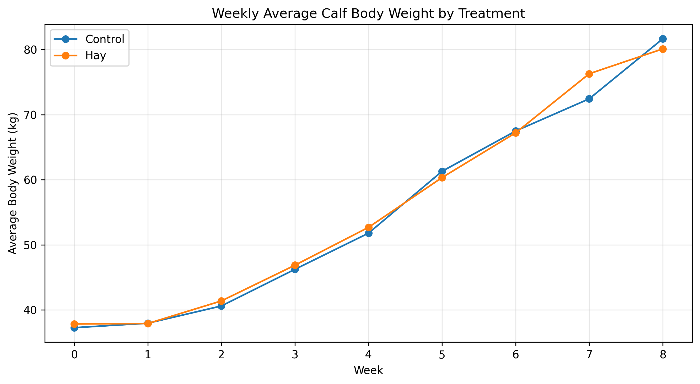
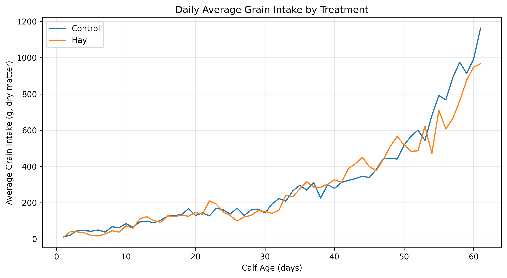
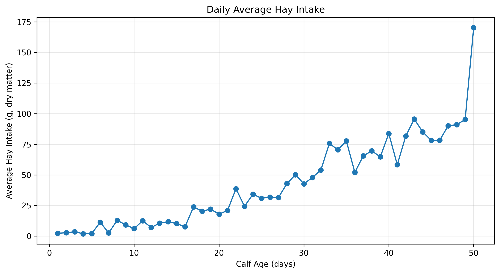
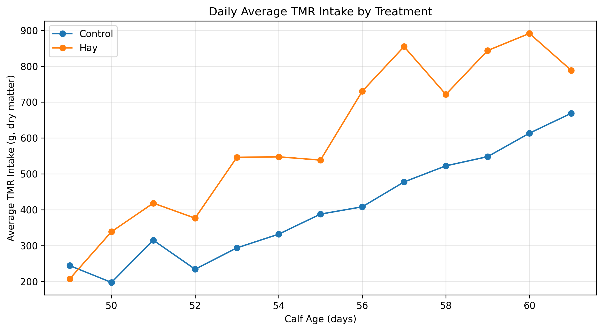

# Dairy Calf Feed Intake, Growth, and Feed Efficiency: An Exploratory Data Analysis

## Project Overview

Feed intake and body-weight development are important aspects of dairy calf management. Understanding how feeding patterns change during early life can help researchers investigate relationships between nutritional intake, animal growth, and feeding behavior during the preweaning period.

This project explores published dairy calf research data to examine feed intake and body-weight development under two treatment conditions: **Control** and **Hay**.

The analysis focuses on daily grain intake, hay intake, total mixed ration (TMR) intake, and weekly average body weight. It also investigates exploratory relationships between feed intake and body weight, considering the potential influence of calf age.

Using Python, pandas, Matplotlib, and SciPy, the project demonstrates an analytical workflow involving data preparation, quality assessment, descriptive statistics, visualization, and exploratory correlation analysis.

The research data were obtained from a published dairy calf study by Downey et al. (2022). The original study included 22 calves, with 11 in the Control group and 11 in the Hay group.

This is an exploratory secondary-data analysis. It does not constitute a new feeding experiment, and the descriptive findings should not be interpreted as definitive evidence of treatment effects.

## Research Question

**How do feed intake and body weight change during the preweaning period in dairy calves, and how do the observed relationships between feed intake and body weight change after accounting for calf age?**

### Research Objectives

1. Examine weekly average body-weight trajectories for the Control and Hay groups.
2. Describe daily grain intake patterns across calf age.
3. Investigate changes in hay intake during the available measurement period.
4. Compare daily average TMR intake between treatment groups.
5. Explore relationships between feed intake and body weight.
6. Compare original intake–weight correlations with correlations after an exploratory adjustment for age.
7. Assess missing data and other limitations affecting interpretation.
8. Develop a reproducible workflow for exploring animal science research data using Python.

## Original Research and Data Sources

The data were obtained from a published dairy calf study.

- **Research dataset:** [Dryad repository — DOI 10.25338/B8V054](https://datadryad.org/dataset/doi:10.25338/B8V054)
- **Research article:** [Journal of Dairy Science — DOI 10.3168/jds.2021-21439](https://doi.org/10.3168/jds.2021-21439)

The original study included 22 calves: 11 in the Control group and 11 in the Hay group.

The original publication and dataset should be consulted for the experimental design, treatment definitions, feeding protocols, measurement procedures, and the authors' original statistical conclusions.

## Datasets Analyzed

### 1. Weekly Calf Body Weight and Average Daily Gain

Body-weight observations were summarized by treatment and week to examine growth trajectories.

The analysis also examined observed weight change and average daily gain (ADG). Endpoint-based calculations made in this project are distinguished from the ADG measure supplied by the original study.

### 2. Daily Grain Intake

Daily grain intake measurements were used to investigate changes in average intake across calf age and compare the Control and Hay groups.

### 3. Daily Hay Intake

Hay-intake observations were used to describe changes in recorded hay consumption during the available measurement period.

### 4. Daily Total Mixed Ration Intake

TMR observations were used to compare daily average intake between the two treatment groups during the available measurement period.

Feed intake measurements are reported on a dry-matter basis in the source data.

## Data Preparation and Quality Assessment

The analytical workflow included:

- Loading and inspecting the research datasets.
- Examining dataset dimensions and column types.
- Checking missing values and duplicate records.
- Reviewing treatment-group coverage.
- Examining age ranges and measurement coverage.
- Summarizing body-weight and intake observations.
- Identifying differences in data completeness among feeding datasets.

### Reported Missing Data

| Dataset | Missing records reported |
|---|---:|
| Grain intake | 8.33% |
| Hay intake | 23.01% |
| TMR intake | 20.33% |

These percentages are taken from the project analysis and should be interpreted in the context of each dataset's structure and expected measurement coverage.

Missing intake values were retained as missing rather than automatically imputed. Nevertheless, incomplete observations can affect the number of records contributing to averages and correlation calculations.

## Methods

The analysis was conducted in Python using Google Colab.

1. **Data inspection:** Loaded the datasets and examined their structure, variables, and age coverage.
2. **Data validation:** Checked missing values, duplicates, column types, and treatment coverage.
3. **Descriptive growth analysis:** Summarized body weight by treatment and week.
4. **Feed-intake visualization:** Plotted grain, hay, and TMR intake across calf age.
5. **Treatment comparison:** Compared daily average TMR intake descriptively between the two groups.
6. **Correlation analysis:** Examined relationships between feed intake and body weight.
7. **Exploratory age adjustment:** Compared original correlations with correlations obtained after a residual-based adjustment for age.
8. **Scientific interpretation:** Considered sample size, missing data, repeated measurements, and the limitations of causal inference.

Matplotlib was used for visualization, and SciPy was used for exploratory statistical procedures.

## Visual Results

### Figure 1. Weekly Average Calf Body Weight by Treatment



*Figure 1. Weekly average body weight of dairy calves in the Control and Hay groups.*

Average body weight increased over the observation period in both groups. The two trajectories were broadly similar, although the relative positions of the group averages varied across weeks.

The Hay group had slightly higher averages at several intermediate observations, while the Control group had a higher average at the final plotted week.

These are descriptive patterns. The figure alone cannot establish whether the differences are statistically significant or whether the treatment caused them.

### Figure 2. Daily Average Grain Intake by Treatment



*Figure 2. Daily average grain intake by treatment group across calf age.*

Average grain intake generally increased with calf age in both groups, although the daily means fluctuated.

The two trajectories followed broadly similar upward patterns, with differences in their relative positions at different ages.

The figure illustrates why age should be considered when examining relationships between feed intake and body weight. It does not establish that one treatment caused greater intake.

### Figure 3. Daily Average Hay Intake



*Figure 3. Daily average hay intake during the available measurement period.*

The recorded hay-intake averages generally increased over the measurement period, with fluctuations across days.

The final plotted observation is notably higher than the preceding observations. This should be interpreted cautiously rather than assumed to represent a typical daily intake level.

Missing observations and the small number of calves also affect the interpretation of the daily averages.

### Figure 4. Daily Average TMR Intake by Treatment



*Figure 4. Daily average TMR intake by treatment group during the available measurement period.*

Average TMR intake increased overall in both groups, although the trajectories fluctuated.

The Hay group had a higher observed daily average than the Control group on 12 of the 13 days examined, according to the reported project results.

This is a descriptive comparison of group averages, not proof that the Hay treatment increased TMR intake. Formal inference would need to account for the original experimental design and repeated observations from individual calves.

## Key Findings

### 1. Body weight increased in both treatment groups

Mean body weight increased over the study period in both groups.

The reported endpoint-based weight changes were approximately:

- **Control:** 41.4 kg
- **Hay:** 41.8 kg

These values are descriptive summaries. The small difference does not establish a treatment effect without an appropriate statistical comparison.

### 2. Grain intake generally increased with age

Average grain intake followed an overall upward trajectory in both groups, although daily values fluctuated.

### 3. Hay intake generally increased

Recorded hay intake increased overall during the available measurement period. Missing observations should be considered when interpreting the pattern.

### 4. TMR intake was descriptively higher in the Hay group on most observed days

The Hay group had a higher observed daily average TMR intake on 12 of the 13 days examined. This does not independently establish statistical significance or causation.

### 5. Original intake–weight correlations weakened after age adjustment

Grain and hay intake had positive original correlations with body weight. These correlations were weaker after the exploratory residual-based adjustment for age.

The age-adjusted TMR intake–weight correlation was close to zero.

These results suggest that age may account for part of the association observed between some intake measurements and body weight. However, the exploratory adjustment does not fully account for repeated observations within calves.

### 6. Missing data differed across feeding datasets

Missing records were reported in all three intake datasets, with the highest reported percentage in the hay dataset. Different levels of missingness and age coverage can affect comparability among analyses.

## Scientific Interpretation

### Why age matters

Calf age is related to both body weight and feeding patterns. As calves mature, body weight generally increases, while feed intake can change with development and feeding management.

Consequently, a positive correlation between intake and body weight may partly reflect the shared influence of age.

The weaker correlations after exploratory age adjustment indicate that the original relationships should not be interpreted without considering this temporal influence.

### Why group averages do not establish treatment effects

Daily and weekly averages are useful for visualizing patterns but can conceal differences among individual calves.

Repeated measurements from the same animal are not statistically independent. Therefore, a valid treatment-effect analysis should account for individual calves, repeated observations, and the original experimental design.

### Interpretation of the results

The project is best understood as an exploratory examination of published animal science data. It identifies descriptive patterns and potential relationships but does not establish that hay provision caused changes in calf growth or feed intake.

## Limitations

1. **Small sample size:** The original study included 22 calves, with 11 animals per group.
2. **Repeated measurements:** Multiple observations from the same calf are not independent.
3. **Missing intake data:** All three feeding datasets contained missing observations.
4. **Different observation periods:** Grain, hay, and TMR datasets cover different age ranges.
5. **Exploratory age adjustment:** The residual-based approach is not a substitute for an appropriate longitudinal model.
6. **Descriptive treatment comparisons:** Differences in averages do not establish statistical significance or causality.
7. **ADG definitions:** Endpoint-based ADG calculations may differ from the study-provided measure.
8. **Secondary-data analysis:** Conclusions must remain consistent with the original study design and measurement procedures.

## Future Research Directions

Potential extensions include:

- **Longitudinal growth modeling:** Use an appropriate mixed-effects model to account for repeated body-weight measurements within calves.
- **Treatment-by-age analysis:** Investigate whether growth trajectories differ between groups over time.
- **Age-adjusted feeding relationships:** Examine intake–weight associations using models that account for repeated measurements and potentially nonlinear age effects.
- **Missing-data assessment:** Investigate whether missing intake observations are associated with age, treatment, or other observed variables.
- **Comparison with the original publication:** Evaluate the exploratory results against the original authors' statistical analyses.
- **Feed efficiency analysis:** Investigate an appropriate feed-efficiency measure if the available intake and growth data support a clearly defined calculation.

These are proposed research directions, not completed analyses.

## Tools and Technologies

- Python
- pandas
- Matplotlib
- SciPy
- Google Colab
- GitHub

The tools support the investigation of animal science questions. The primary focus is calf growth, feeding patterns, and interpretation of nutritional and growth measurements.

## Repository Structure

```text
dairy-calf-feed-intake-growth-analysis/
├── data/
│   └── [prepared research datasets]
├── figures/
│   ├── weekly_average_calf_weight.png
│   ├── daily_grain_intake_by_treatment.png
│   ├── daily_hay_intake.png
│   └── daily_tmr_intake_by_treatment.png
├── notebooks/
│   └── [analysis notebook]
├── results/
│   └── feed_intake_weight_correlations.csv
├── requirements.txt
├── LICENSE
└── README.md
```

*Replace bracketed entries with the actual filenames in your repository before publishing.*

### Exported Results

#### `feed_intake_weight_correlations.csv`

This file summarizes the comparison of feed-intake and body-weight correlations before and after adjustment for age.

It is intended to document:

- Relationships between grain, hay, and TMR intake and body weight.
- Original versus exploratory age-adjusted correlations.
- Sample sizes and statistical outputs generated by the analysis.

These correlations are exploratory and should not be interpreted as definitive treatment effects.

## Reproducibility

To reproduce the analysis:

1. Clone or download the repository.
2. Obtain the research dataset from the [Dryad repository](https://datadryad.org/dataset/doi:10.25338/B8V054).
3. Open the analytical notebook in Google Colab or a compatible Jupyter environment.
4. Follow the notebook's data-loading and preparation instructions.
5. Install dependencies listed in `requirements.txt`.
6. Run the notebook cells in sequence.
7. Compare the generated figures and statistical outputs with the exported results.

Reproduction depends on the actual notebook, data-loading configuration, file paths, and dependency versions documented in the repository.

## Conclusion

This project explores dairy calf growth and feeding patterns using published animal science research data.

Average body weight increased in both treatment groups, while grain and hay intake generally increased during their available measurement periods. The Hay group also had higher observed TMR intake averages on most of the days examined.

The exploratory correlation analysis indicates that some original intake–weight relationships weakened after adjustment for age, highlighting the importance of considering calf development when interpreting feeding and growth measurements.

The results remain descriptive. The small sample, repeated measurements, missing intake observations, and limitations of the exploratory age adjustment prevent definitive conclusions about treatment effects.

Overall, the project demonstrates how data preparation, statistical analysis, and visualization can be applied to animal science questions while maintaining appropriate scientific caution.

## About the Author

**Richard Antwi**

BSc in Agriculture, majoring in Animal Science

Research interests include animal nutrition, livestock growth and production, sustainable agricultural systems, and quantitative approaches to agricultural research.

This project forms part of my agricultural research portfolio, which applies data analysis to questions concerning animal growth, feeding patterns, and agricultural productivity.

---

**Data source:** Downey et al. (2022), published dairy calf research dataset.

**Research approach:** Exploratory secondary-data analysis.

*Findings should be interpreted in the context of the original experimental design and the limitations described above.*
